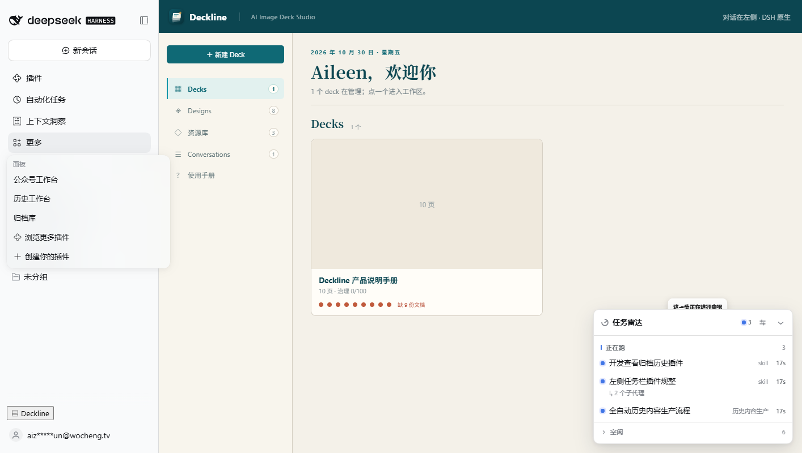
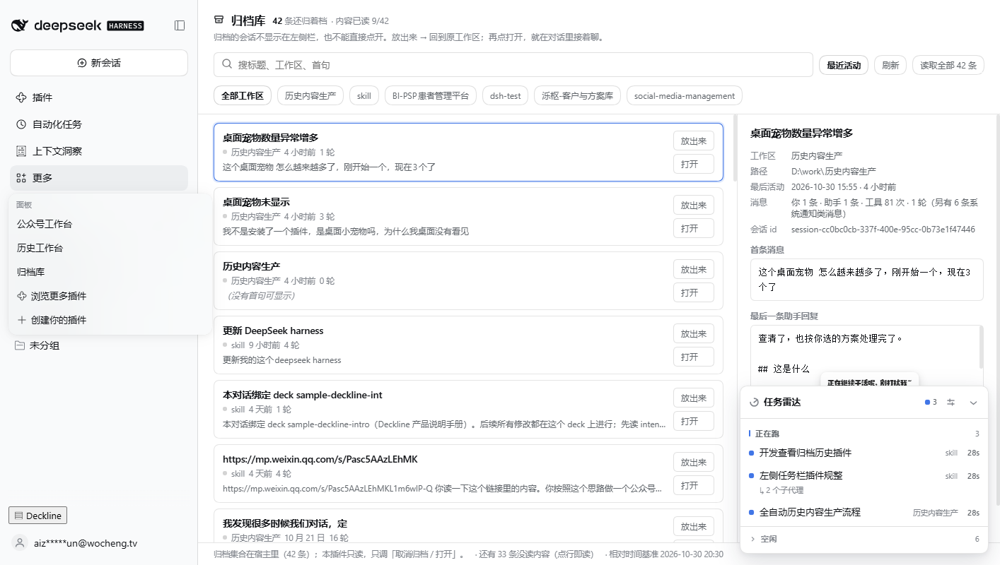
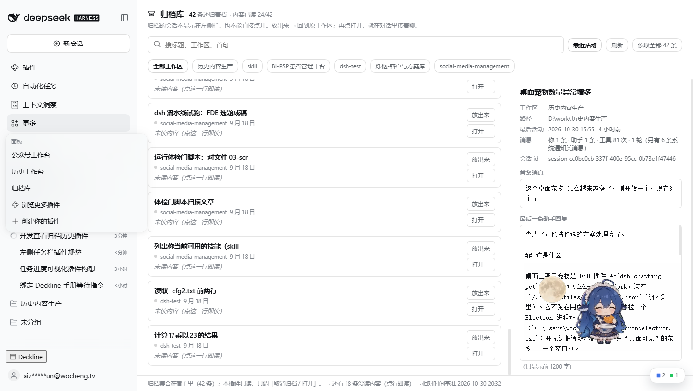

# dsh-plugin-archive-shelf · 归藏

挂在 DSH 主区上的**归档会话面板**：把宿主里归档掉的会话一次列全，看得到它聊了什么，
`放出来` 就回到原工作区，`打开` 直接进对话接着聊。

---

## 它解决的是哪一步

宿主本来就有「归档」：会话行 → `归档`，会话从所有分组里消失，集合落在
`~/.dsh/storages/workspace.json` 的 `archivedSessionIds`（本机现在是 **43 条**）。

归档之后想找回来，宿主给了三段路，每一段都差一口气：

| 宿主给的路 | 差在哪 |
| --- | --- |
| 侧栏视图选项 →「筛选已归档会话」 | 能看见行，但和普通行长得一样，还得一条条点开辨认 |
| 行菜单 →「取消归档」 | 得先在几十行里找到它 |
| 点归档行 | 宿主弹一句「已归档，打不开」——想接着聊，必须先取消归档再回去翻侧栏 |

本插件把这三步合成一屏：**列表 → 看内容 → 放出来 → 打开继续聊**。

## 面板上有什么

- **顶部**：还在归档里几条、本次放出来几条、内容读到了几条（`已读 12/43` 是进度，不是装饰）。
- **搜索**：标题、工作区、首句、会话 id 短号都算；空格分开是多词同时命中。
- **工作区筛选**：只列真有归档会话的工作区；点一下切，再点一下取消。
- **排序**：`最近活动`（默认）↔ `归档顺序`（宿主给的原样，不自己排）。
- **每行**：标题、工作区、最后活动（相对时间）、轮次、首句灰字；右侧两个按钮。
- **右栏详情**：工作区 / 路径 / 最后活动 / 消息条数与工具次数 / 会话 id，
  以及**首条消息**、**最后一条助手回复**、**最后一条你的消息**（都能原地滚动看全文）。
- **首句优先取"你本人说的"**：宿主的 `user/message` 里混着审批策略变更、运行上下文、
  定时任务、别的 agent 的消息……直接拿第一条会让人误以为会话是那么开的。所以只把
  `source.kind === "user"` 算作"你"，通知类单独计数；一条人话都没有时才退回通知
  （标在详情里：`另有 N 条系统通知类消息`）。
- **两个动作**：
  - `放出来` → `uiWorkspace.unarchiveSession()`，会话回到原工作区的原位置；
  - `打开继续聊` → 没放出来的先放出来，再 `uiWorkspace.openSession()`，
    主区直接切回那个会话（宿主行为：一旦选中会话就 `selectPanel(null)`）。

双击行首也能打开；放出来之后行不会立刻消失，会变成「已放出来」留在列表里等你点打开，
点「刷新」才按宿主快照重排。

## 长什么样（真机截图，2026-10-30 在本机跑出来的）

| 左侧栏「更多」里的入口 | 面板（42 条归档） |
| --- | --- |
|  |  |

| 没读过的行如实说「未读」 | 放出来之后真的能接着聊 |
| --- | --- |
|  |  |

最后一张就是闭环证明：`放出来` → `打开继续聊` → 主区切回那条旧会话，输入框可以继续发消息。

## 没读到首句时的三种说法

「还没读」「读不到」「读到了但没有你说的话」是三件事，画成同一句「空会话」就是骗人：

| 行的状态 | 灰字写什么 |
| --- | --- |
| 还没预取到（24 条之外） | `未读内容（点这一行即读）` |
| 读失败 | `日志读取失败` |
| `sessionQuery` 没挂上 / 回放校验不过 | `内容读不到（只有标题和时间）` |
| 日志里 0 个事件 | `这条会话日志是空的（建了就归档了）` |
| 有事件但没有人话 | `日志里没有你说的话（只有系统通知）` |

## 数据边界（重要）

```
宿主（只读）                          本插件
├── archivedSessionIds（归档集合）      ├── /api/archive-shelf.preview   一条摘要
├── useSessions（标题/时间/工作区）     ├── /api/archive-shelf.batch     最多 24 条
└── 会话日志（冷读，不激活会话）        └── 浏览器内存里的预取结果（不落盘）
```

- **只读**：不写 `workspace.json`、不改会话日志、不 retain 会话。
  归档集合的写口永远在宿主那边——本插件只调宿主的两个动作。
- **冷读**：摘要来自 `ctx.sessionQuery.readSession()`（回放校验过的完整日志），
  **不会让归档会话变活**，也不会拉进模型上下文。
- **不猜**：sessionQuery 没挂上、日志读不出来，就如实回 `available:false`，
  面板标「内容读不到」，而不是画一个空会话。截断（每段 1200 字）也如实标出来。
- **不落盘**：预览只在浏览器内存里，刷新就重读；不在 localStorage 里存会话内容。

## 路由（都在 `/api` 下，走 Connection 的浏览器信任栅栏）

```
GET /api/archive-shelf.preview?session=<id>
  → { ok, sessionId, available, title, cwd, createdAt, updatedAt,
      counts:{events,user,assistant,tools,turns},
      firstUser:{text,truncated}, lastUser:{…}, lastAssistant:{…},
      snippet, truncated }
  → available:false 时带 code: "session-query-unavailable" | "read-failed"

GET /api/archive-shelf.batch?ids=<a,b,c>   （去重、跳过非法、最多 24 条、并发 3）
  → { ok, items:[…同 preview…], skipped }
```

非法 `session` 参数一律 400（`bad-session`），不拿去读日志。摘要按会话 id 缓存最近 200 条。

## 装 / 卸

```yaml
# ~/.dsh/profiles/web/cordis.patch.yml
- insert:
  - id: archive-shelf
    name: 'dsh-plugin-archive-shelf'
```

`~/.dsh/profiles/web/package.json` 里加 `"dsh-plugin-archive-shelf": "link:D:/work/skill/plugins/dsh-plugin-archive-shelf"`，
`node_modules` 里一个同名 junction 指回本目录。**卸掉就是删这两处**——插件不写任何自己的目录。

侧栏：`sidebar-tidy` 只留 `插件 / 自动化任务 / 上下文洞察` 三行，所以「归档库」自动进 **更多**；
想让它常驻侧栏，把 `archive-shelf` 加进 `dsh-plugin-sidebar-tidy/client.js` 的 `KEEP_IDS`。

## verify

```bash
node verify/parse-unit.mjs      # 日志 → 摘要的纯函数（截断、计数、空快照、通知类消息）
node verify/host-smoke.mjs      # 假 ctx 打真路由：参数校验、缓存、并发、读取失败
node verify/client-harness.mjs  # 假 React + 假 ModuleLoader：注册、首屏、放出来、打开
node verify/real-log-sample.mjs # 拿本机真实归档日志跑一遍（只读；形状变了会当场红）
```

前三条都不碰正在跑的 `dsh web`（重启会打断所有宿主会话），也不碰真实归档集合。
第四条只**读** `~/.dsh/sessions`，不写、不激活会话；它是唯一能证明"宿主今天写出来的
事件信封还是我理解的那形状"的手段——合成事件证明不了这件事。

## 已知边界

- **日志里的标题常常是"兜底标题"**：`session/title` 事件的 `source.kind` 为 `fallback` 时，
  它是拿首条消息前几个字截的；真正的名字在宿主的会话清单里。所以列表标题优先用清单的
  `displayTitle`，日志标题只在清单没有时才兜底。
- **归档时间看不到**：宿主只存 id，不存「什么时候归档的」；面板只显示最后活动时间，不编一个。
- **日志特别大时会慢**：冷读一条几 MB 的日志要整段回放（本机最大那条 11 MB / 1 万个事件）。
  所以首屏只预取前 24 条（并发 3），其余等你点开那一行时单条补读；想一次读完就点顶部的
  「读取全部 N 条」。左下角写着「还有 N 条没读内容」，不假装都读过了。
- **放出来之后不会自动跳转**：`打开继续聊` 才跳；只点 `放出来` 是让它先回侧栏。
- 文案只有中文；不注册 locale 命名空间，避免和宿主版本耦合。
